# Bitcoin option calibration in the browser

**Price, calibrate and analyse Deribit BTC options with 28 jump and stochastic-volatility models, entirely in the
browser: no computing server, nothing to install.**

▶ **Live demo: https://yassinebarnicha.github.io/calibration-btc-svjd/** · 📄 **[Report (PDF)](REPORT.pdf)**


## What the application does

- **Interactive calibration**: every slider reprices the whole option chain of the day live; five optimisers (classic
  and adaptive Nelder–Mead, differential evolution, DE then Nelder–Mead), Feller constraint, lockable parameters,
  bounds, several days calibrated together.
- **Composable models**: a variance block × a jump law, each with its dynamics written out in LaTeX.
- **Greeks**: the model's Δ, Γ, Vega, Θ (finite differences on its own pricer) against Black-76, by strike.
- **3-D volatility surface**: the model surface and the market points, calibrated only or all of them, with the model's
  extrapolation where it has seen nothing.
- **Pricer on demand**: one option typed in, or a whole CSV file returned with prices, IVs and Greeks (format below).
- **Exotics by Monte Carlo**: Asian, barrier, digital, lookback, American (Longstaff-Schwartz), composite payoffs or a
  free formula, with an automatic check against the exact Fourier price.
- **GEX (gamma exposure)**: market makers' gamma exposure by strike, flip level, call / put walls.
- **Static replication (Carr–Madan)**: any payoff at expiry (presets or a free formula) rebuilt with the future and the
  options listed that day; cost at the mark, mid and bid/ask, value under the model and under the interpolated smile,
  replication error; the log contract gives the model-free implied volatility (the method of the VIX and DVOL).
- **Data**: 270+ days of Deribit option chains since January 2024 (open interest included), the futures history,
  529 calibrated parameter sets, and one more day every morning.
- **Computer and phone**: numbered vertical navigation on a large screen; on a phone, full-width smiles, two sliding
  panels and the optimisation button always within thumb's reach.

## Models

| Variance \ jumps | none | Merton | bi-lognormal | Kou | CGMY | Variance Gamma | NIG |
|---|:---:|:---:|:---:|:---:|:---:|:---:|:---:|
| Black-Scholes | ✓ | ✓ | ✓ | ✓ | ✓ | ✓ | ✓ |
| Heston | ✓ | ✓ (Bates) | ✓ | ✓ | ✓ | ✓ | ✓ |
| Double Heston | ✓ | ✓ | ✓ | ✓ | ✓ | ✓ | ✓ |
| Heston + variance jumps | ✓ | ✓ | ✓ | ✓ | ✓ | ✓ | ✓ |

The 28 compositions are priced through their characteristic function with **COS** (Fang–Oosterlee 2008) or **PROJ**
(Kirkby 2015), written in JavaScript. The [report](REPORT.pdf) derives the characteristic functions, the two Fourier
methods, the loss functions and the optimisers, and shows the results on real data.

## How it works

- **A fully static site**: `index.html` (the page, its pricers and one day embedded), one file per day in `jours/`,
  loaded on demand. All the computing runs in the visitor's browser, which keeps its settings (browser, or a folder of
  the disk with Chrome and Edge): no database, no account.
- **Data that update themselves**: a GitHub Action downloads the Deribit option chain every morning (public API, no
  key), adds it and republishes the page. The *↻ Today* button does the same from the browser, at any time.
- **Fast and fluid** (measured in Chrome, Bates model, 6 maturities, 222 options, COS): a full evaluation ≈ 1.3 ms,
  about **650 evaluations per second** during an optimisation; a screen refresh ≈ 3.5 ms. The optimisation runs in
  12 ms slices: the screen keeps its 60 frames per second.
- **Mathematics typeset in LaTeX**: formulas are rendered once at build time with KaTeX (vendored in `katex/`), so the
  page runs no math script; system fonts only, no external library.
- **A dark "midnight glass" design**, the same as the portfolio ([docs/DESIGN.md](docs/DESIGN.md)).

## Validation

- Put–call parity and martingale property: C(K = F) − P(K = F) = 0.0000 bp on the 28 compositions; Black-Scholes
  recovered to within 0.005 bp; JavaScript pricer equal to the Python reference pricer to within 6·10⁻⁶ $.
- Greeks by finite differences equal to the Black-76 closed forms (Black-Scholes model) to the decimals shown.
- Monte Carlo: the simulated European falls within 2 standard errors of the Fourier price on six model families;
  zero early-exercise premium for r = 0, positive for r > 0.
- Time to expiry counted to the hour up to the 08:00 UTC expiry, which matters for maturities of a few days.
- Pricer optimisations checked against the previous version on the 28 compositions, COS and PROJ: identical prices up
  to rounding noise (4.5·10⁻⁸ relative); the COS series is cut where its remainder is bounded below 10⁻¹⁰ $.
- Static replication (`node tests/test_replication.js`, 28 checks): the weights and strike selection of
  TooManyOptions reproduced exactly; the interpolation weights equal the payoff at every listed strike (kinks
  included); a call is replicated by that single call; the model-free variance of flat Black-76 prices returns the
  volatility (60.002 % for 60 %); executable cost = ask of the purchases − bid of the sales.

## Previews

| 3-D volatility surface | GEX |
|---|---|
| 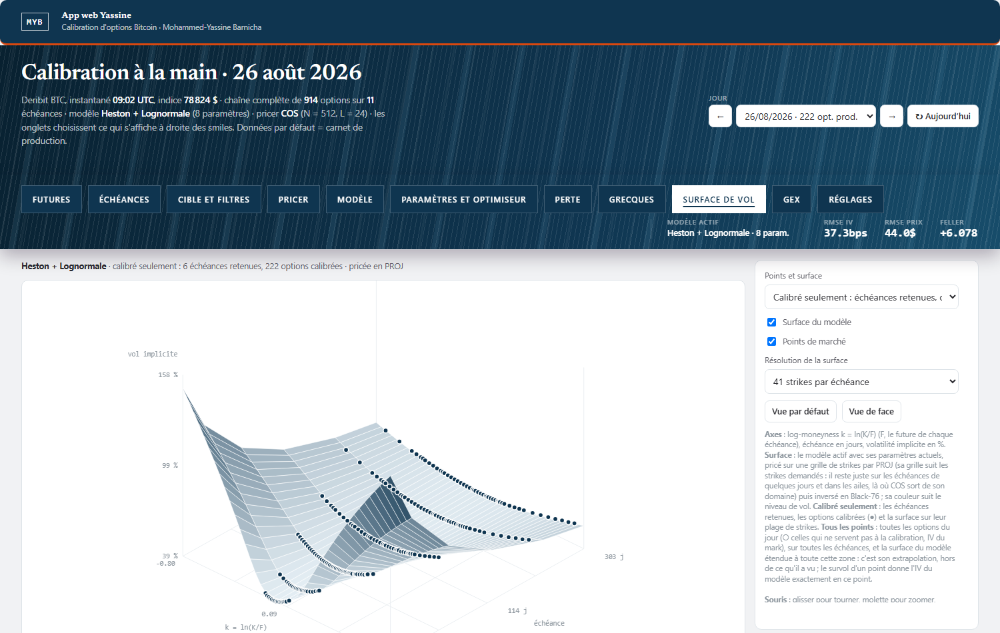 |  |

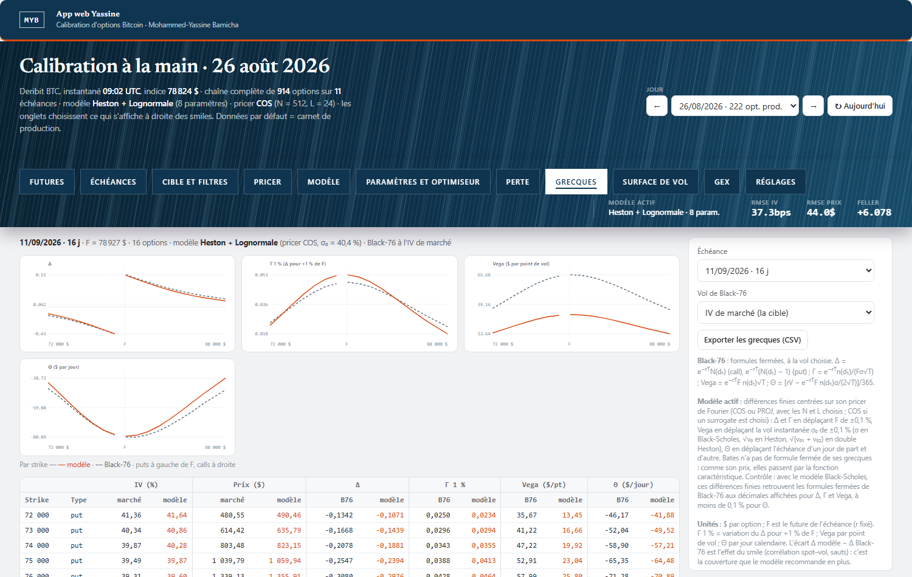

**On a phone** — left the page (one maturity per row, "Optimise" pinned at the bottom), middle the tab panel, right the
settings panel of the tab:

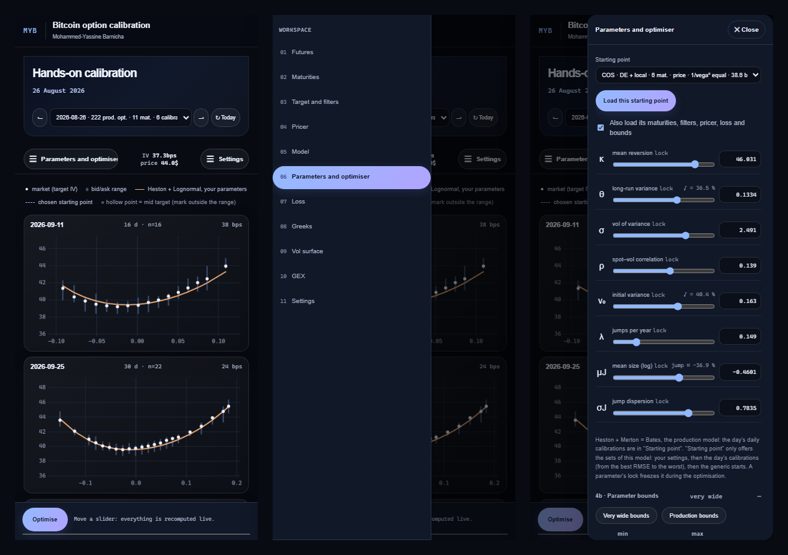

## Every view

Each tab, on 2026-08-26 (calibrated Bates model). Click an image to enlarge it.

| | |
|---|---|
| **Futures — path of each future since its listing**<br>[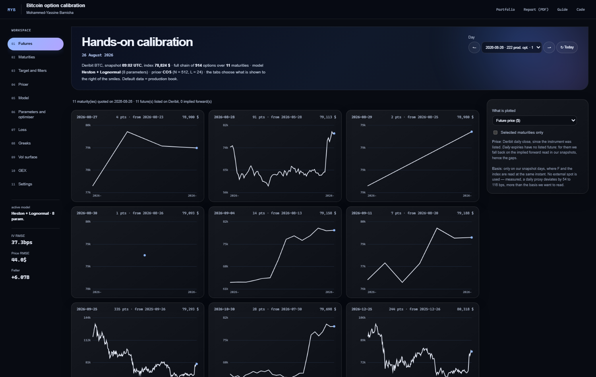](docs/captures/01_futures.png) | **Maturities — choice of the calibrated maturities**<br>[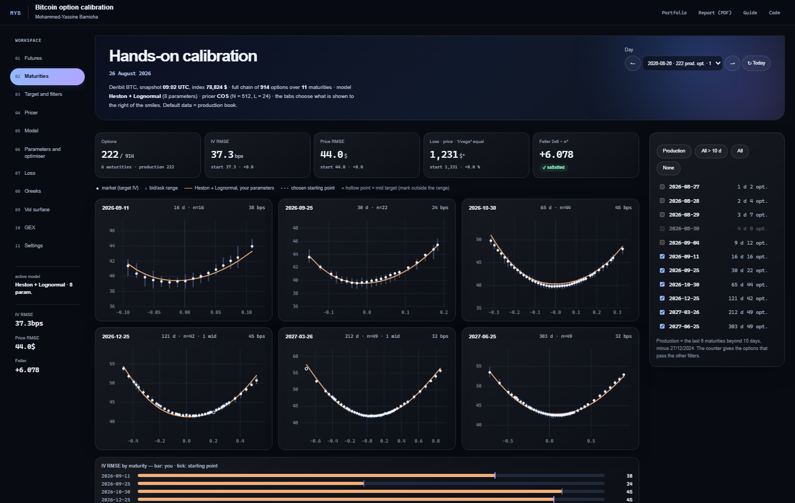](docs/captures/02_maturities.png) |
| **Target and filters — target price, spreads, moneyness**<br>[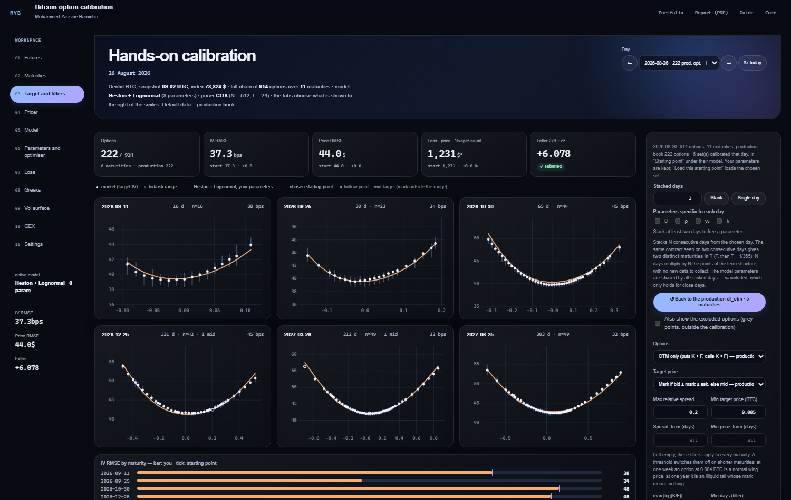](docs/captures/03_target_filters.png) | **Pricer — COS / PROJ, options typed in, CSV, Monte Carlo**<br>[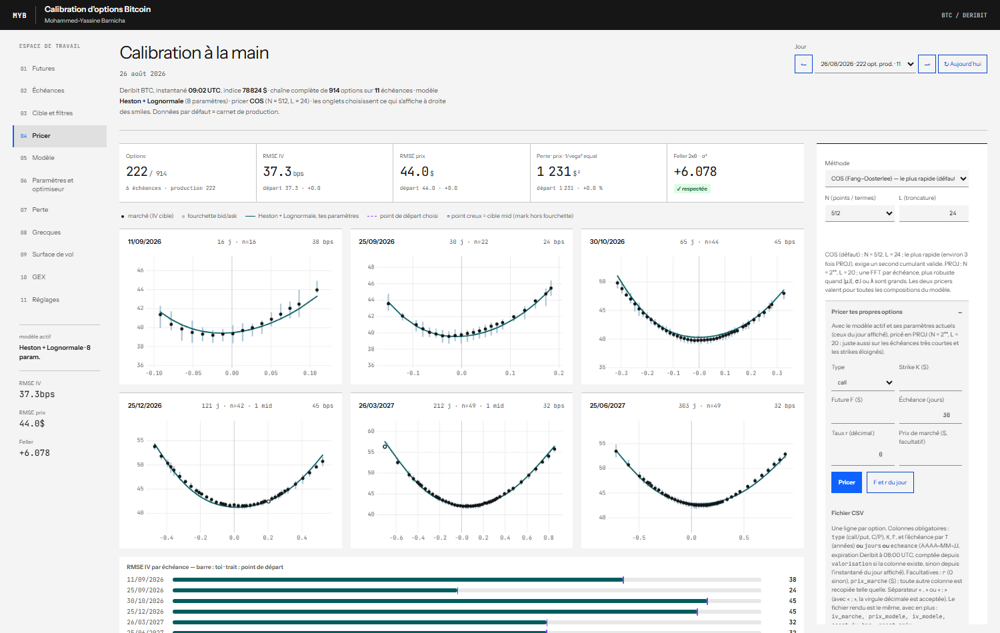](docs/captures/04_pricer.png) |
| **Model — variance × jumps, dynamics in LaTeX**<br>[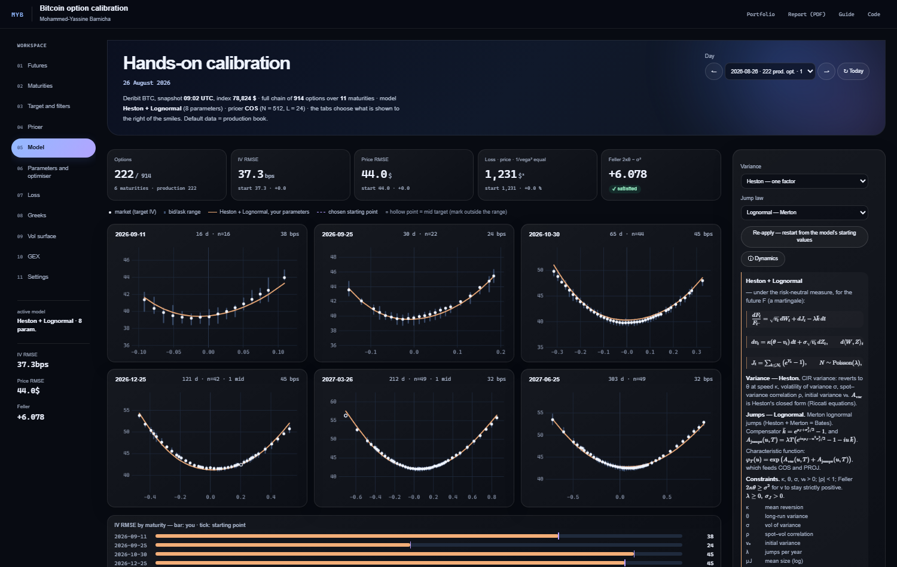](docs/captures/05_model.png) | **Parameters and optimiser — sliders, five optimisers**<br>[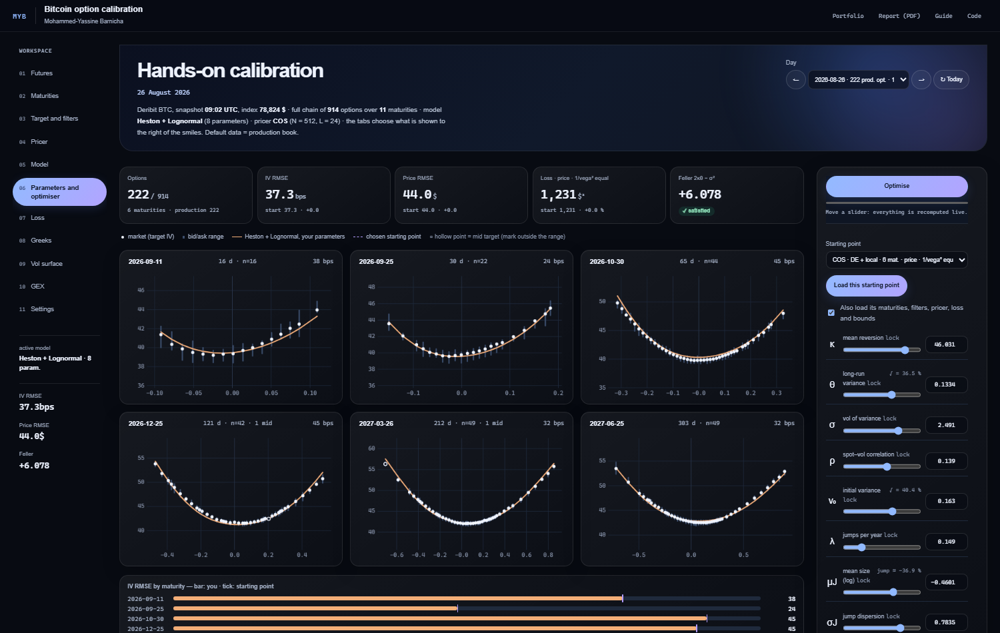](docs/captures/06_parameters_optimiser.png) |
| **Loss — measure and weighting of the error**<br>[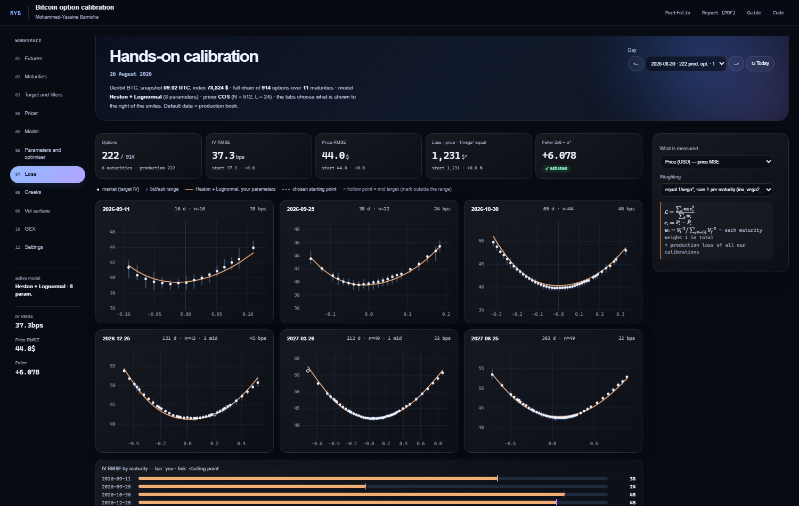](docs/captures/07_loss.png) | **Greeks — model against Black-76, by strike**<br>[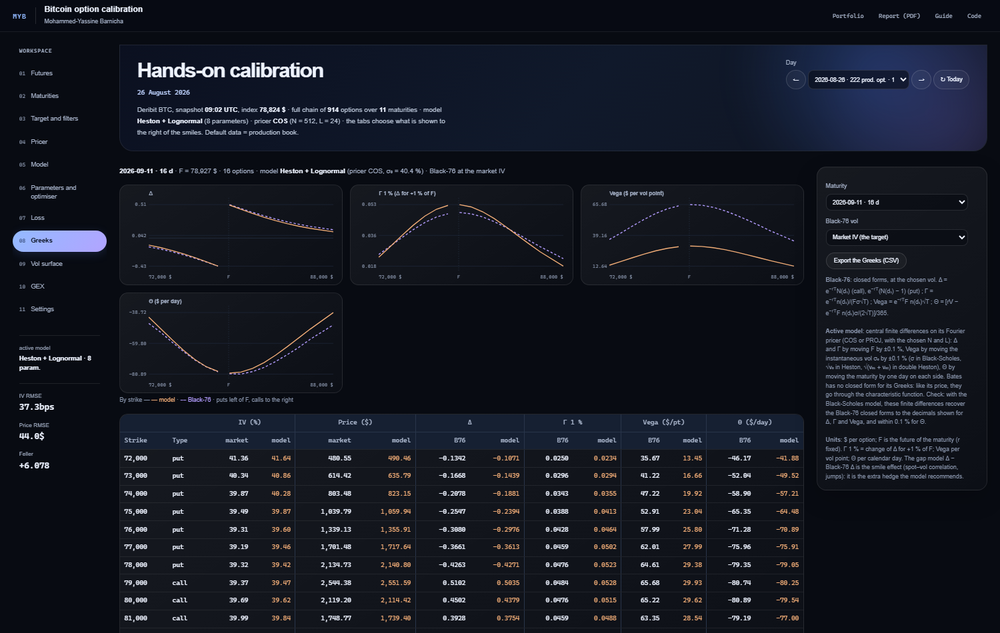](docs/captures/08_greeks.png) |
| **Vol surface — 3-D, model and market**<br>[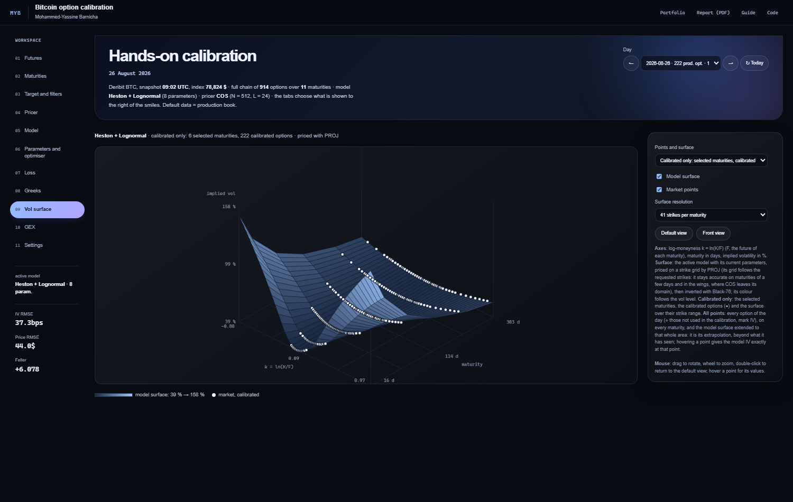](docs/captures/09_vol_surface.png) | **GEX — gamma exposure, flip level**<br>[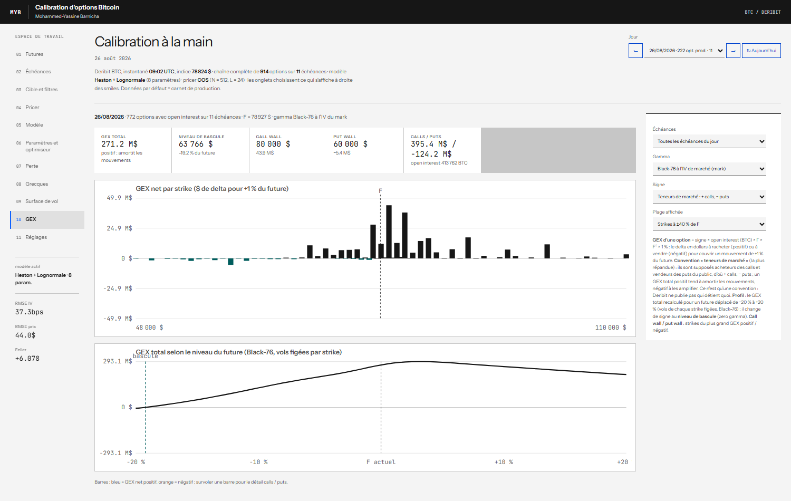](docs/captures/10_gex.png) |
| **Settings — saving and exporting parameter sets**<br>[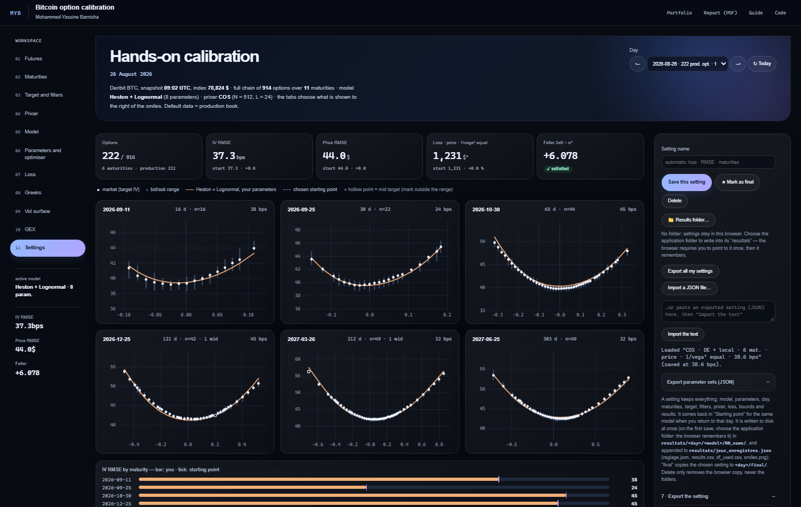](docs/captures/11_settings.png) | **On a phone** — page, tab panel, settings panel<br>[](docs/apercu_mobile.png) |

## Getting started

- **Online**: open the demo, on a computer or a phone. A tab opens directly from the address, for example `…/#GEX` or
  `…/#Vol%20surface`.
- **Locally**: download the repository and double-click `index.html` (keep `jours/`, `katex/`, `futures.js` and
  `jeux.js` next to it).
- **On a phone**: "☰" at the top left chooses the tab, "☰ Settings" at the top right opens its settings, "Optimise"
  stays at the bottom of the screen; touching the dark veil closes a panel.

## CSV format of the pricer

*Pricer* tab → *Price your own options* → *Price a CSV…*: the file comes back (`<name>_price.csv`) with, in addition to
its columns, the model price and IV, the market IV, the gaps, and the Δ, Γ, Vega, Θ of the model and of Black-76.

```csv
id,type,K,F,jours,r,prix_marche
put-70k,put,70000,83757,30,0.06,1245.5
call-95k,call,95000,83757,30,0.06,980
atm-90j,call,84000,83757,90,0.06,
```

Required: `type` (call/put, C/P), `K`, `F` and the maturity as `T` (years) **or** `jours` (days) **or** `echeance`
(YYYY-MM-DD, 08:00 UTC expiry). Optional: `r`, `prix_marche` (market price); any other column is copied. Separator `,`
or `;` (decimal comma accepted with `;`, as in a French Excel). Column names are kept from the original format so that
existing files keep working. Details in the [guide](docs/GUIDE.md).

## Going further

- [REPORT.pdf](REPORT.pdf): the theory and the algorithms (model composition, characteristic functions, Fourier
  pricers, loss, optimisers, Greeks, GEX, Monte Carlo, validation, results); LaTeX source in `docs/report/`.
- [docs/GUIDE.md](docs/GUIDE.md): full user guide (each tab, CSV format, scripts, data updates, publishing).
- [docs/DESIGN.md](docs/DESIGN.md): design rules (colours, layout, computer and phone).
- Development: the page is built from `sources/` (`template_full.html`, `design.css`, `pricer.js`) with
  `python sources/build.py`; a new model is added through its exponent in `pricer.js` and its entry in the template.

## Author and licence

Mohammed-Yassine Barnicha — code under the [MIT](LICENSE) licence; KaTeX (`katex/`, `sources/katex/`) under its own MIT
licence. Market data: public Deribit API.
