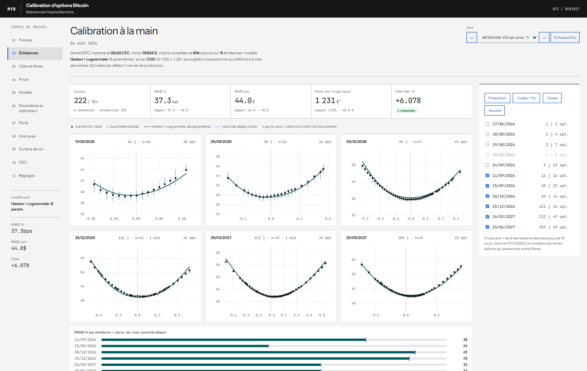
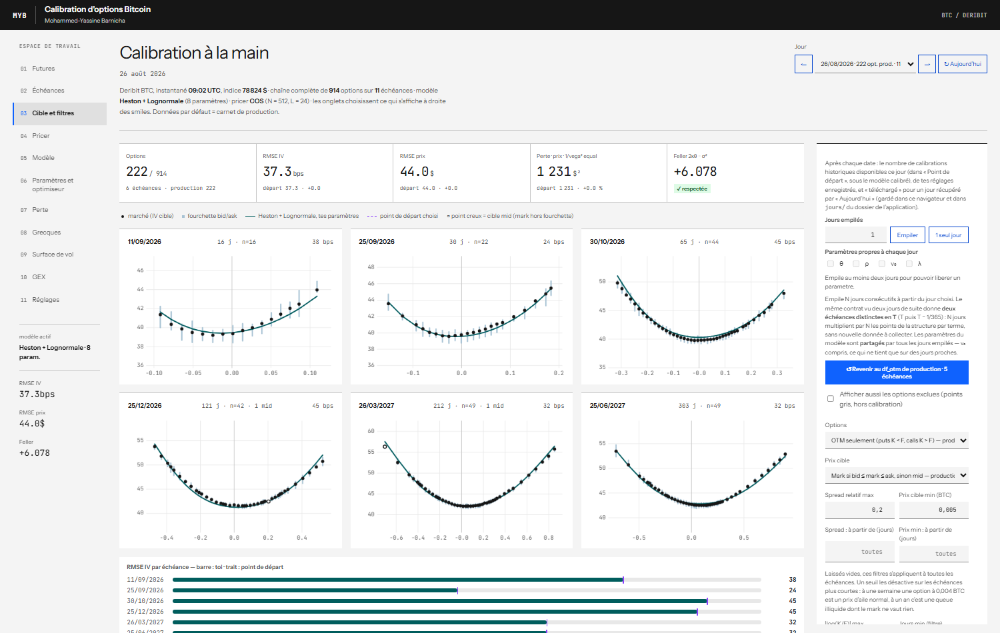
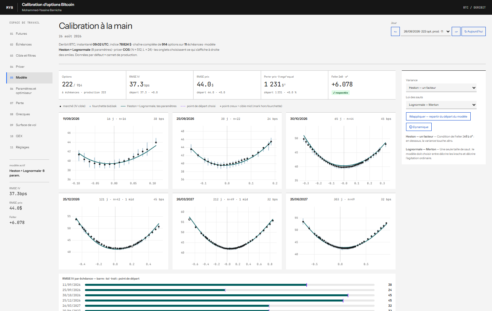
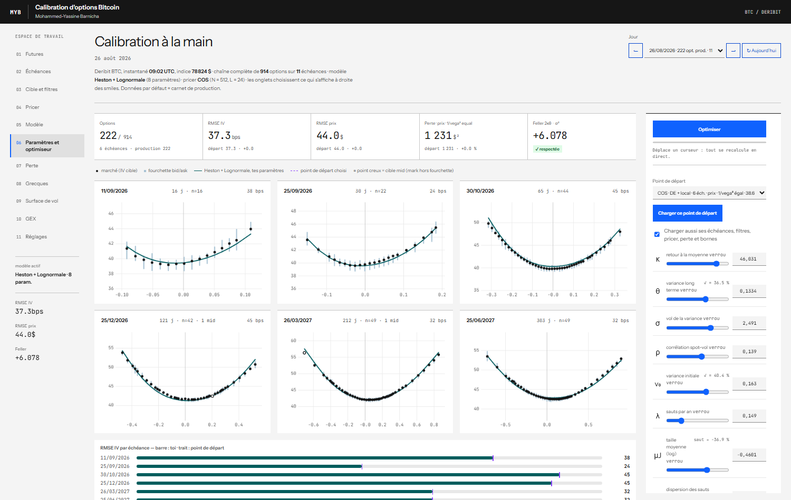
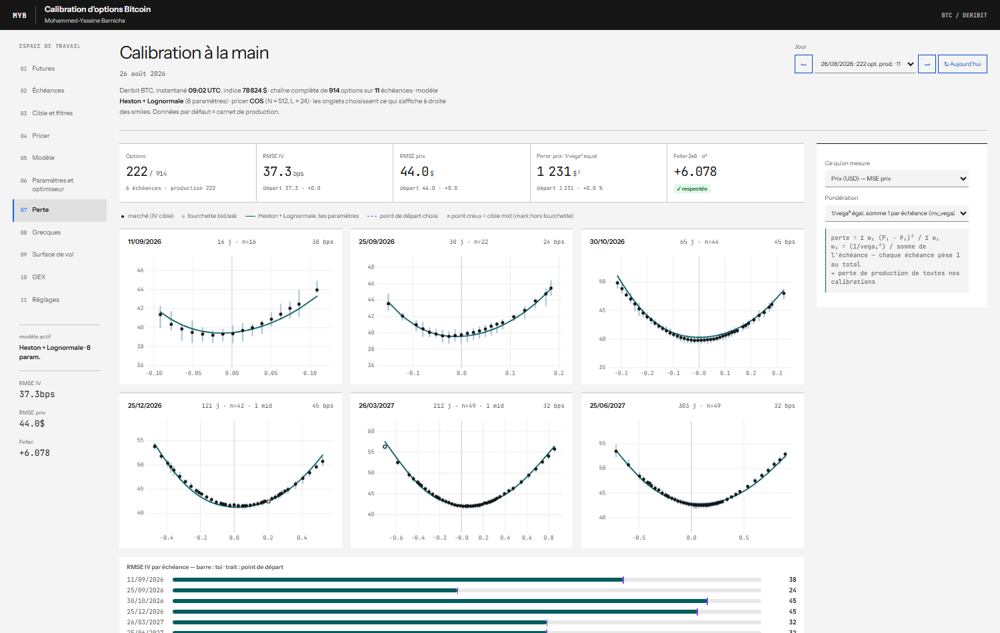
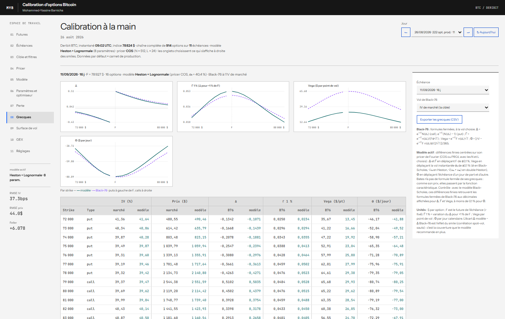
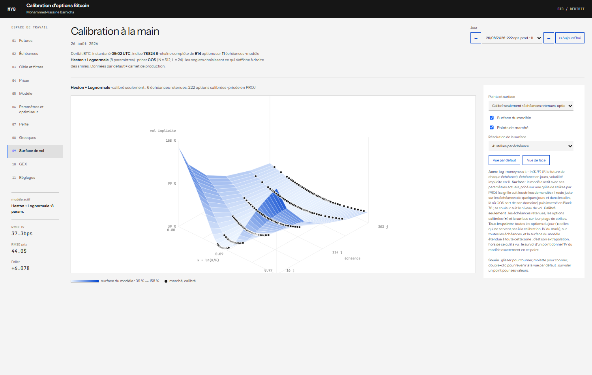
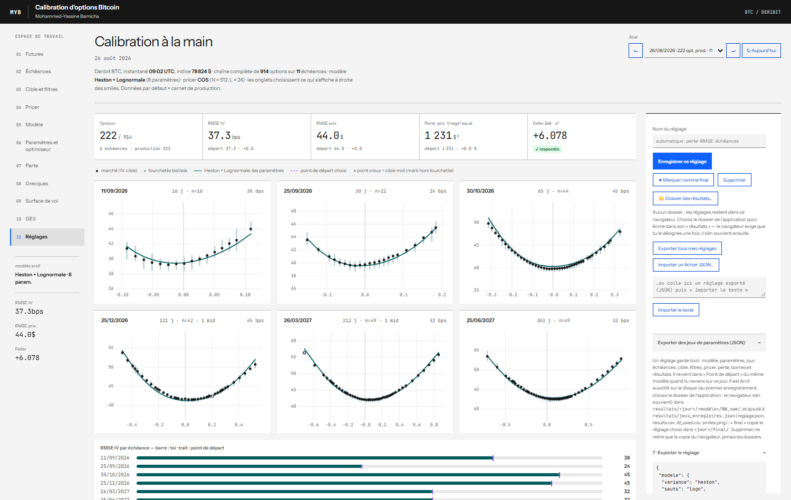

# Calibration d'options Bitcoin dans le navigateur

**Pricer, calibrer et analyser les options BTC de Deribit avec onze modèles à sauts et volatilité stochastique,
entièrement dans le navigateur : aucun serveur de calcul, aucune installation.**

▶ **Démo en ligne : https://yassinebarnicha.github.io/**


## Ce que fait l'application

- **Calibration interactive** : chaque curseur repricé en direct sur toute la chaîne d'options du jour ; cinq
  optimiseurs (Nelder–Mead classique et adaptatif, évolution différentielle, DE puis Nelder–Mead), contrainte de
  Feller, paramètres verrouillables, bornes, plusieurs jours calibrés ensemble.
- **Modèles composables** : un bloc de variance × une loi de sauts, chacun avec sa dynamique affichée en clair.
- **Grecques** : Δ, Γ, Vega, Θ du modèle (différences finies sur son propre pricer) contre Black-76, par strike.
- **Surface de volatilité 3D** : surface du modèle et points de marché, calibrés seulement ou tous, avec
  l'extrapolation du modèle là où il n'a rien vu.
- **Pricer à la demande** : une option saisie à la main, ou un fichier CSV entier rendu avec prix, IV et grecques
  (format ci-dessous).
- **Exotiques par Monte-Carlo** : asiatiques, barrières, digitales, lookbacks, américaines (Longstaff-Schwartz),
  payoffs composés ou formule libre, avec contrôle automatique contre le prix exact de Fourier.
- **GEX (gamma exposure)** : exposition gamma des teneurs de marché par strike, niveau de bascule, call / put walls.
- **Données** : 270+ jours de chaînes d'options Deribit depuis janvier 2024 (open interest compris), l'historique
  des futures, 529 jeux de paramètres calibrés, et un jour de plus chaque matin.
- **Ordinateur et téléphone** : navigation verticale numérotée sur grand écran ; sur téléphone, les smiles en
  plein écran, deux volets glissants et le bouton d'optimisation toujours à portée de pouce.

## Modèles

| Variance \ sauts | aucun | Merton | bi-log-normal | Kou | CGMY | Variance Gamma | NIG |
|---|:---:|:---:|:---:|:---:|:---:|:---:|:---:|
| Black-Scholes | ✓ | ✓ | ✓ | ✓ | ✓ | ✓ | ✓ |
| Heston | ✓ | ✓ (Bates) | ✓ | ✓ | ✓ | ✓ | ✓ |
| Double Heston | ✓ | ✓ | ✓ | ✓ | ✓ | ✓ | ✓ |
| Heston + sauts de variance | ✓ | ✓ | ✓ | ✓ | ✓ | ✓ | ✓ |

Les 28 compositions sont pricées par leur fonction caractéristique, avec **COS** (Fang–Oosterlee 2008) ou
**PROJ** (Kirkby 2015), écrits en JavaScript.

## Comment ça marche

- **Un site 100 % statique** : `index.html` (la page, ses pricers et un jour intégrés), un fichier par jour dans
  `jours/`, chargé à la demande. Tout le calcul tourne dans le navigateur du visiteur, qui garde ses réglages chez
  lui (navigateur, ou dossier de son disque avec Chrome et Edge) : aucune base de données, aucun compte.
- **Des données qui se mettent à jour seules** : une GitHub Action télécharge chaque matin la chaîne d'options
  Deribit (API publique, sans clé), l'ajoute et republie la page. Le bouton *↻ Aujourd'hui* fait la même chose
  depuis le navigateur, à tout moment.
- **Rapide et fluide** (mesuré dans Chrome, modèle de Bates, 6 échéances, 222 options, COS) : une évaluation
  complète ≈ 1,3 ms, soit environ **650 évaluations par seconde** pendant une optimisation ; un rafraîchissement de
  l'écran ≈ 3,5 ms. L'optimisation tourne par tranches de 12 ms : l'écran garde ses 60 images par seconde.
- **Un design sobre** inspiré des principes du système Carbon (IBM, Apache-2.0) : fond neutre, angles droits,
  chiffres en chasse fixe, aucune bibliothèque externe — la page reste un seul fichier autonome
  ([docs/DESIGN.md](docs/DESIGN.md)).

## Validation

- Parité call–put et martingalité : C(K = F) − P(K = F) = 0,0000 bp sur les 28 compositions ; Black-Scholes retrouvé
  à moins de 0,005 bp ; pricer JavaScript égal au pricer Python de référence à 6·10⁻⁶ $ près.
- Grecques par différences finies égales aux formules fermées de Black-76 (modèle Black-Scholes) aux décimales
  affichées.
- Monte-Carlo : l'européenne simulée tombe à moins de 2 erreurs standard du prix de Fourier sur six familles de
  modèles ; prime d'exercice anticipé nulle pour r = 0, positive pour r > 0.
- Temps à l'échéance compté à l'heure près jusqu'à l'expiration de 08:00 UTC, ce qui compte pour les échéances de
  quelques jours.
- Optimisations du pricer contrôlées contre la version précédente sur les 28 compositions, COS et PROJ : prix
  identiques au bruit d'arrondi près (4,5·10⁻⁸ en relatif) ; la série COS est coupée là où son reste est borné
  sous 10⁻¹⁰ $.

## Aperçus

| Surface de volatilité 3D | GEX |
|---|---|
|  |  |


**Sur téléphone** — à gauche la page (une échéance par rang, « Optimiser » fixé en bas), au milieu le volet des
onglets, à droite le volet des réglages de l'onglet :


## Toutes les vues

Chaque onglet, sur le jour du 26/08/2026 (modèle de Bates calibré). Cliquer sur une image pour l'agrandir.

| | |
|---|---|
| **Futures — trajectoire de chaque future depuis son émission**<br>[](docs/captures/01_futures.png) | **Échéances — choix des échéances calibrées**<br>[](docs/captures/02_echeances.png) |
| **Cible et filtres — prix visé, spreads, moneyness**<br>[](docs/captures/03_cible_filtres.png) | **Pricer — COS / PROJ, options à la main, CSV, Monte-Carlo**<br>[](docs/captures/04_pricer.png) |
| **Modèle — variance × sauts, dynamique affichée**<br>[](docs/captures/05_modele.png) | **Paramètres et optimiseur — curseurs, cinq optimiseurs**<br>[](docs/captures/06_parametres_optimiseur.png) |
| **Perte — mesure et pondération de l'erreur**<br>[](docs/captures/07_perte.png) | **Grecques — modèle contre Black-76, par strike**<br>[](docs/captures/08_grecques.png) |
| **Surface de vol — 3D, modèle et marché**<br>[](docs/captures/09_surface_de_vol.png) | **GEX — gamma exposure, niveau de bascule**<br>[](docs/captures/10_gex.png) |
| **Réglages — enregistrement et export des jeux**<br>[](docs/captures/11_reglages.png) | **Sur téléphone** — page, volet des onglets, volet des réglages<br>[](docs/apercu_mobile.png) |

## Démarrer

- **En ligne** : ouvrir la démo, sur ordinateur ou sur téléphone. Un onglet s'ouvre directement par l'adresse, par
  exemple `…/#GEX` ou `…/#Surface%20de%20vol`.
- **En local** : télécharger le dépôt et double-cliquer sur `index.html` (garder `jours/`, `futures.js` et
  `jeux.js` à côté).
- **Sur téléphone** : « ☰ » en haut à gauche choisit l'onglet, « ☰ Réglages » en haut à droite ouvre ses réglages,
  « Optimiser » reste en bas de l'écran ; toucher le voile sombre referme un volet.

## Format CSV du pricer

Onglet *Pricer* → *Pricer tes propres options* → *Pricer un CSV…* : le fichier revient (`<nom>_price.csv`) avec,
en plus de ses colonnes, prix et IV du modèle, IV de marché, écarts, Δ, Γ, Vega, Θ du modèle et de Black-76.

```csv
id,type,K,F,jours,r,prix_marche
put-70k,put,70000,83757,30,0.06,1245.5
call-95k,call,95000,83757,30,0.06,980
atm-90j,call,84000,83757,90,0.06,
```

Obligatoires : `type` (call/put, C/P), `K`, `F` et l'échéance par `T` (années) **ou** `jours` **ou** `echeance`
(AAAA-MM-JJ, expiration 08:00 UTC). Facultatives : `r`, `prix_marche` ; toute autre colonne est recopiée.
Séparateur `,` ou `;` (virgule décimale acceptée avec `;`, comme dans Excel en français). Détail dans le
[guide](docs/GUIDE.md).

## Pour aller plus loin

- [docs/GUIDE.md](docs/GUIDE.md) : mode d'emploi complet (chaque onglet, format CSV, scripts, mise à jour des
  données, publication).
- [docs/DESIGN.md](docs/DESIGN.md) : règles du design (couleurs, grille, ordinateur et téléphone).
- [METHODOLOGIE_app_web_yassine.pdf](METHODOLOGIE_app_web_yassine.pdf) : théorie et algorithmes (composition des
  modèles, pricers de Fourier, perte, optimiseurs, validation).
- Développement : la page se construit depuis `sources/` (`template_full.html`, `design.css`, `pricer.js`) avec
  `python sources/build.py` ; un nouveau modèle s'ajoute par son exposant dans `pricer.js` et sa fiche dans le
  gabarit.

## Auteur et licence

Mohammed-Yassine Barnicha — code sous licence [MIT](LICENSE). Données de marché : API publique de Deribit.
